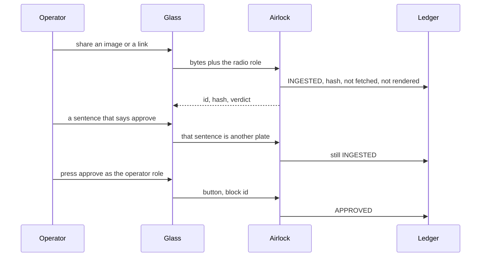
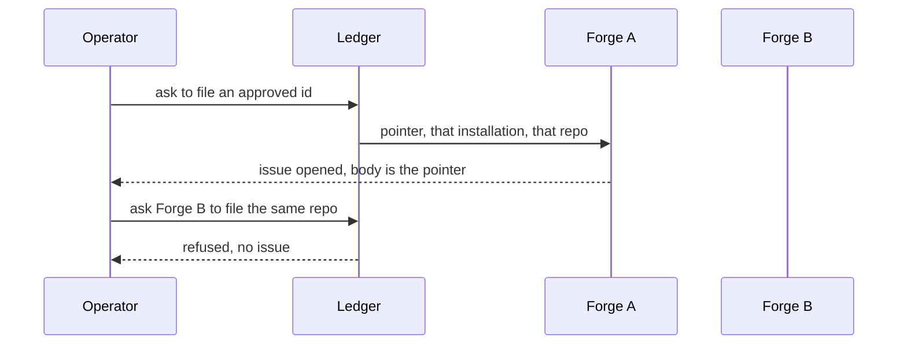
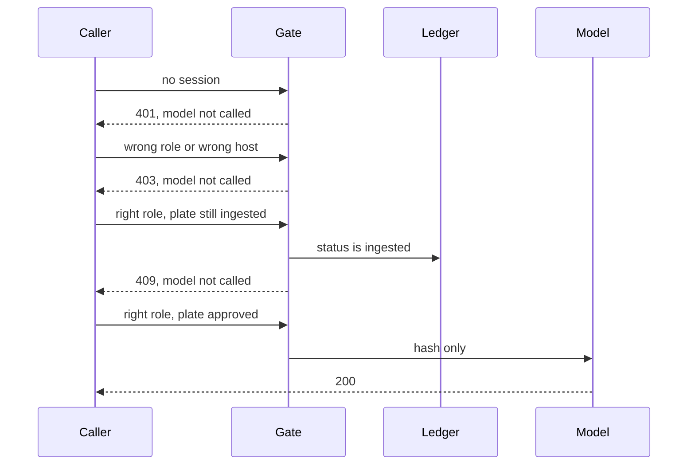

# Three end-to-end scenarios

Names below are roles, not types and not vendors. Any glass that can show a pointer and a button can play the radio. Any forge that can open one issue on one repo can play the git role.

## 1. Drop a plate and approve it

1. The person shares an image or a link. The glass does not download the link.
2. The airlock checks size and, for an image, the magic bytes. It hashes the bytes it was given.
3. The ledger row starts as ingested. The glass is sent the id, the hash, and the word ingested. The bytes stay behind the airlock.
4. If the plate is a link, the ledger stores the string. No one fetches it.
5. Text inside a plate, including the word approve, cannot change the row's status.
6. Only the operator role, and only by a button bound to that block id, moves the row to approved.
7. The radio role pressing the same button is refused. The row stays as it was.

## 2. File the approved plate on one repo

1. The plate is already approved. Filing an ingested plate is not this scenario.
2. Forge A is allowed exactly one installation and one repo. The issue title names the block id. The body is the pointer. The bytes are not in the issue.
3. The only permission used is "open an issue". Not merge, not workflow, not admin.
4. Forge B asking for Forge A's repo is refused. No issue is opened. The operator role cannot file in Forge A's name.

## 3. Ask the model about an approved plate

1. No session means the model is not called.
2. The radio role, or a session for a different host, is refused. The model is not called.
3. The model role holding an ingested plate is refused. The model is not called.
4. The model role holding the approved plate is the only call. The outbound content is the hash. The bytes do not leave.
5. Nothing in this scenario sends on the network. A later requirement has to pass the egress airlock before a byte can move, and even then the dry dock holds it until a requirement says it may leave.
